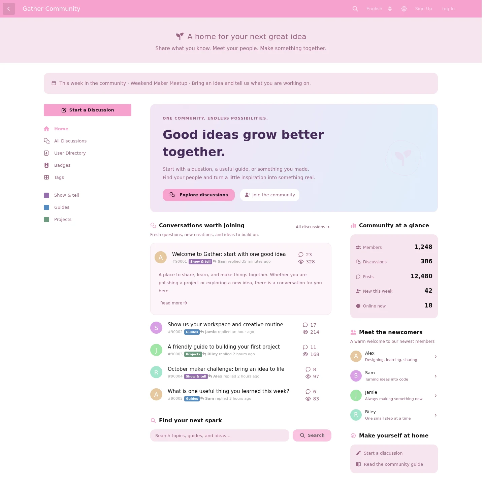
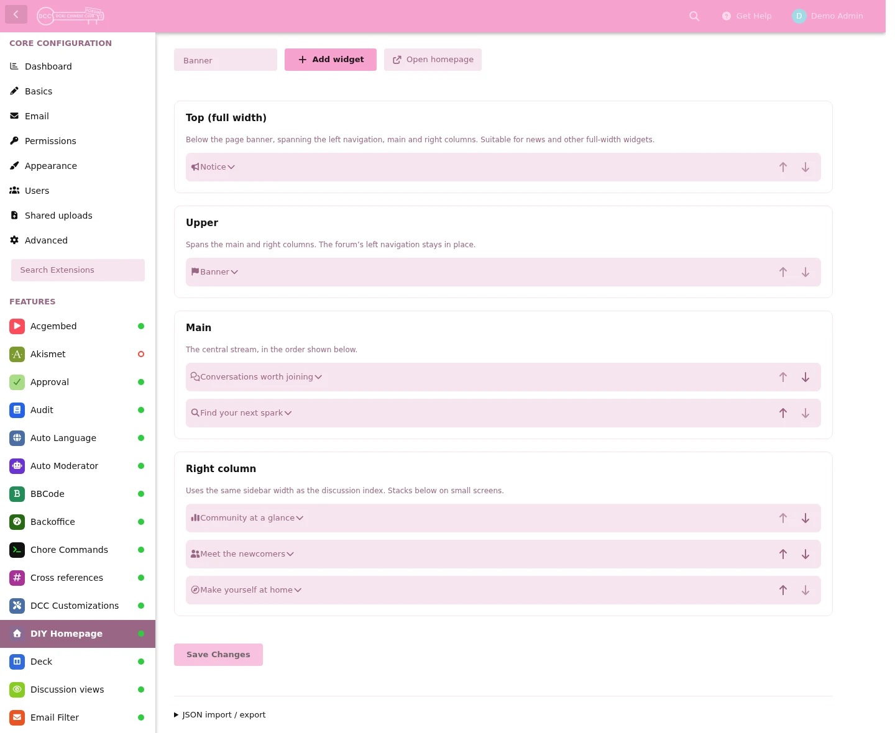
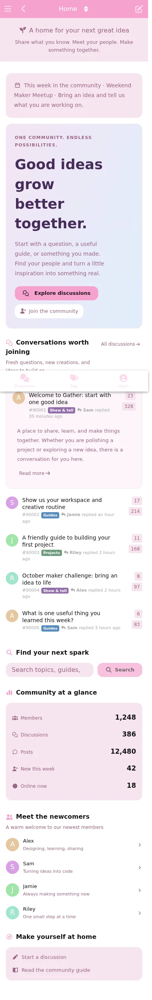
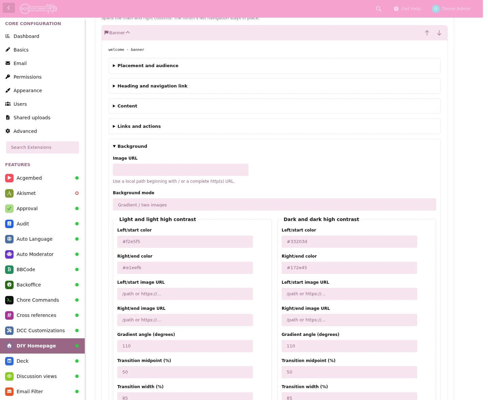

# DIY Homepage

**English** | [简体中文](README.zh-CN.md)

I initially built this extension to replicate the home page feature of https://discuss.flarum.org , but ended creating something even better.

So I decided to open-source this extension for everyone who want to have a beautiful homepage for their flarum deployment.

The most outstanding features of it are **Widget-ized** and **Highly customizable**, you can implement various of modern frontend aesthetic designs without having to touch the code.

This extension is also running on my own deployment: https://forum.monika.love

Notice: This extension was made with massive help of AI, but under careful human supervise and field-tested.

> Anything below this point was written by AI

Build a configurable homepage for Flarum 2. Arrange widgets, content and appearance in a visual admin editor while keeping your forum's existing left navigation.

## Screenshots

Captured in Chromium from a running Flarum 2 installation. The bilingual demonstration uses temporary example content; the pictured theme and other installed extensions are optional.

Homepage · desktop, light theme



Administration · visual layout editor



<details>
<summary>Dark theme, mobile layout and appearance controls</summary>

Homepage · dark theme


Homepage · mobile layout

<a href="docs/screenshots/home-en-mobile.webp"></a>

Administration · separate light/dark backgrounds



</details>

## Features

- Four layout regions: full width, upper, main and sidebar, with an optional sticky sidebar and stacked mobile layout.
- A configuration-only area keeps fully editable widget copies off the homepage while making them available to the optional Friends of Flarum Widgets extension for placement on other pages, with independent content and heading styles.
- Built-in banners, images, notices, discussions, users, statistics, links, search and line/blank dividers.
- Root homepage modes for everyone, guests only or disabled; plain-text variables, explicit primary/secondary buttons, separate statistics fonts and optional bottom padding/gap removal.
- Add, duplicate and reorder widgets, choose guest/member audiences, and import or export layouts as JSON.
- Independent page heading, icon and subtitle; widget backgrounds, gradients, images, text styles and actions with light/dark palettes.
- A default-on page setting can hide the Flarum banner on the DIY homepage only, without affecting All Discussions or other pages, while leaving navigation and browser-tab titles intact.
- Flarum's native discussion and user components, with permission-aware search and configurable page preloading, respecting the current user's visibility rules.
- Widget header controls stay available when collapsed; configuration tabs keep each editor focused.
- Optional two-way FoF Widgets Core bridge: use FoF widgets on the homepage or place homepage widgets in FoF layouts.
- English and Simplified Chinese translations; light, dark and high-contrast theme support.

| Widget | Use it for |
| --- | --- |
| Banner, image, notice | Welcome content, announcements, images and calls to action |
| Discussions | Search-based or selected discussions, optional excerpts and a featured first item |
| Users | Search-based or selected members, with optional biographies |
| Statistics | Totals, recent activity, tag discussion counts and permission-controlled online counts |
| Links, search | Navigation, compose/login actions and discussion search |
| Divider / spacer | A horizontal separator or blank space, with an optional heading |
| FoF widget | An installed and enabled FoF widget provider |

## Installation

Requires PHP `^8.3` and Flarum `^2.0.2`. FoF Widgets Core is optional. Compiled frontend assets are included; Node.js is not needed for installation.

Install the stable package from [Packagist](https://packagist.org/packages/edgeinfinity/diy-homepage) in your Flarum directory:

```sh
composer require edgeinfinity/diy-homepage:"^0.1.4"
php flarum cache:clear
```

## Getting started

1. Enable **DIY Homepage** in the admin panel and open its settings.
2. Start with the supplied five-widget layout. Set the page heading and navigation label, then add, duplicate or rearrange widgets.
3. Choose each widget's region, audience, content and appearance. To show online counts, grant **View online member count (without identities)** on the Permissions page.
4. Click **Save Changes**, then open `/home`. Reload existing forum tabs to load the new configuration.

The **Forum root homepage** setting has three modes. With Flarum's normal All Discussions default:

| Mode | Guests visiting / | Members visiting / |
| --- | --- | --- |
| Enabled | DIY Homepage | DIY Homepage |
| Guests only | DIY Homepage | All Discussions |
| Disabled | All Discussions | All Discussions |

/home always opens DIY Homepage. Other configured forum defaults are retained for users outside the selected audience; a global /home default falls back to /all when this setting excludes that user. Existing installations keep their previous behavior, and new installations default to guests only.

Use {username}, {displayName}, {forumTitle} and {forumDescription} in display text. Visitors receive a translated Guest name. Double braces, such as {{username}}, keep the token literal. Text is escaped by the renderer; variables do not expand in URLs or queries.

Add a per-use default with `{username, "Guest"}` or `{forumDescription, "Welcome"}`. It is used when that known value is missing or empty; `{username, ""}` is allowed. Use a double-quoted JSON string. Unknown names or malformed syntax stay literal, and defaults are never expanded again. Existing tokens without defaults retain their behavior.

Button color defaults to Automatic, preserving existing styling. Divider widgets support a line or blank space, a configurable 0–300px content height, and a normal heading. Statistics labels and numbers have separate font size, family and weight controls. Both bottom-padding and bottom-gap switches are off by default. See the full documentation for the supported text fields and JSON keys.

The online-count permission grants counts only, without access to the online member list. Imported FoF widgets retain their providers' settings and permissions.

## Documentation and support

- [Full documentation](docs/DOCUMENTATION.md): detailed configuration, backgrounds and text, statistics permissions, JSON format, custom widgets and the FoF bridge.
- [Changelog](CHANGELOG.md), [contributing](CONTRIBUTING.md) and [release procedure](RELEASING.md).
- [Report an issue](https://github.com/edgeinfinity1/flarum-diy-homepage/issues) with your Flarum/PHP versions and steps to reproduce it.

## License

[MIT](LICENSE).
