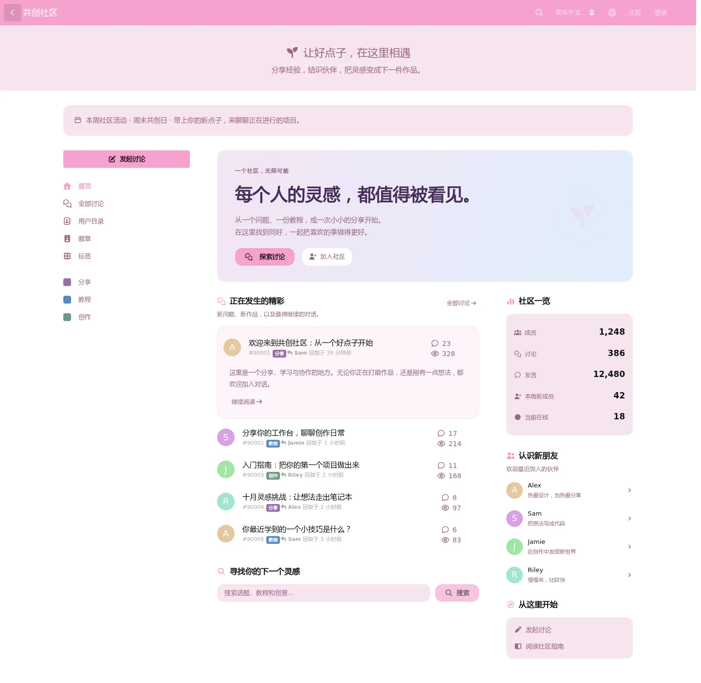
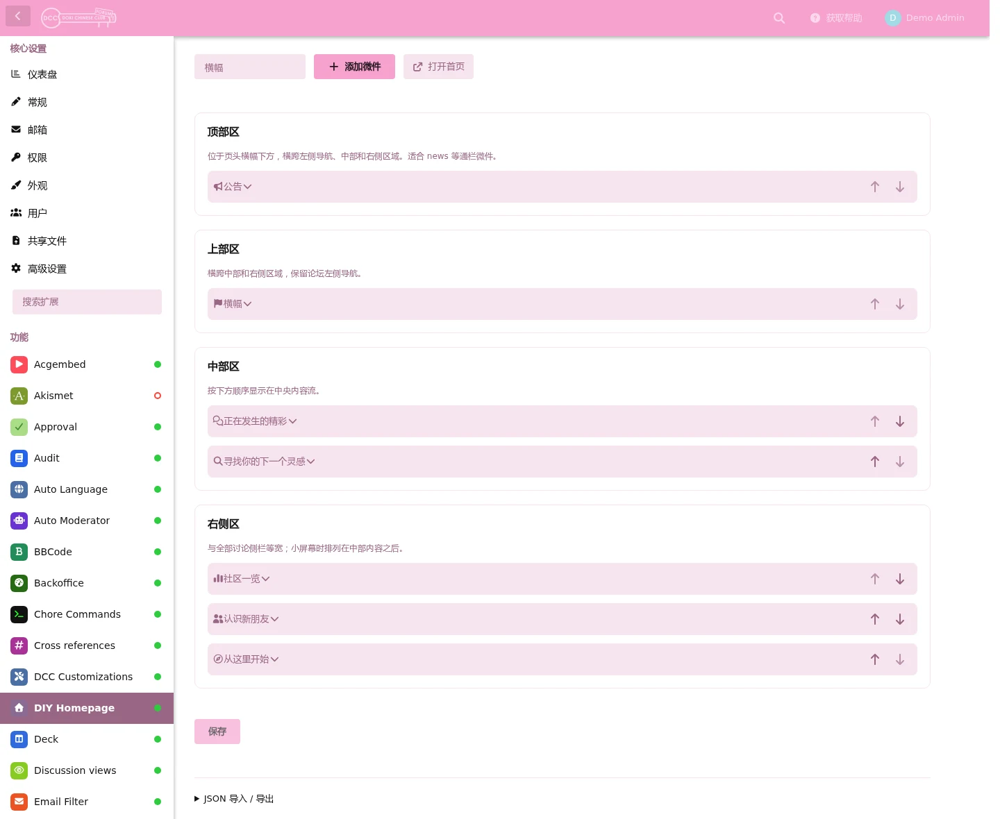
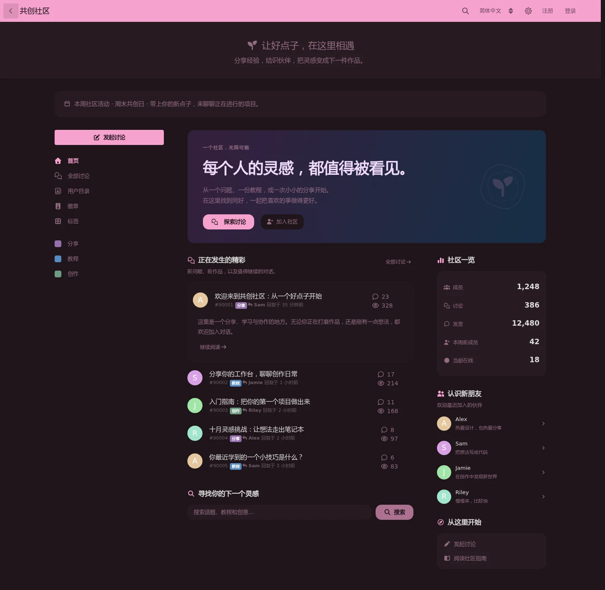
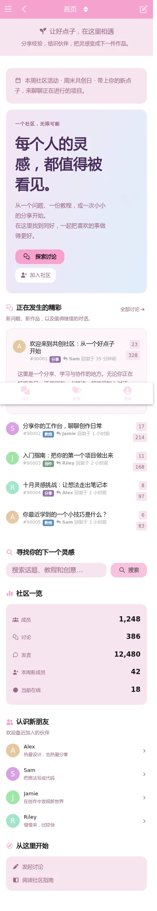
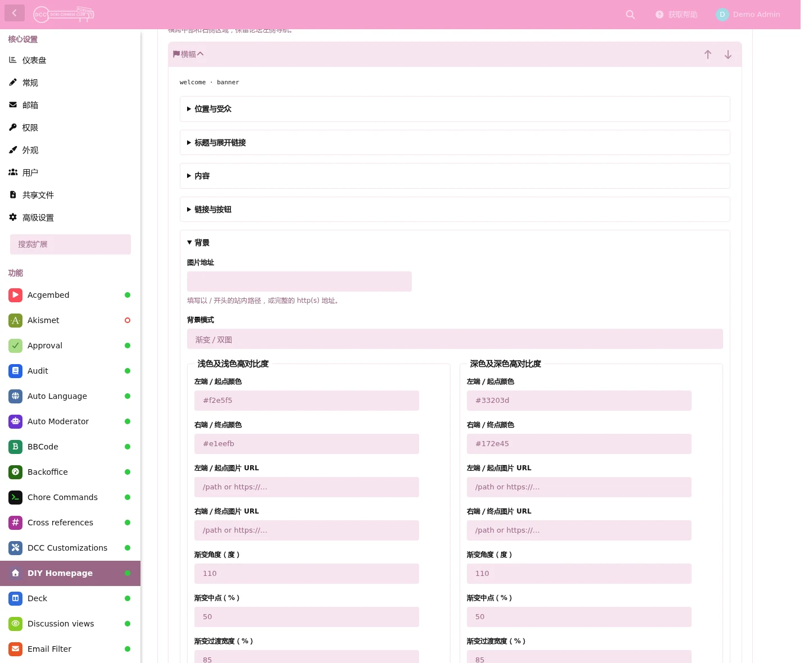

# DIY Homepage

[English](README.md) | **简体中文**

我最开始做这个插件是想复刻 https://discuss.flarum.org 的首页功能, 但实际做出来的效果我觉得比它的强多了.

所以我开源发布这个插件, 打扮出来的首页可以很漂亮.

它的特点是**微件化**和**高度可自定义**, 不改代码也可以实现现代前端常见的很多美术设计.

这个插件也在我自己的论坛上运行: https://forum.monika.love

注意: 大量开发工作由AI完成, 但均由我监管且经过测试.

> 下面的内容就都是AI写的了

为 Flarum 2 构建可自由组合的首页。通过后台可视化编辑器安排微件、内容和外观，同时保留论坛原有的左侧导航。

## 实机截图

以下截图通过 Chromium 在运行中的 Flarum 2 环境拍摄，使用临时双语演示内容。图中的主题和其它扩展为该环境的可选配置。

首页 · 桌面浅色主题



后台 · 可视化布局编辑器



<details>
<summary>查看深色主题、手机布局和外观设置</summary>

首页 · 深色主题



首页 · 手机布局

<a href="docs/screenshots/home-zh-CN-mobile.webp"></a>

后台 · 独立浅色／深色背景设置



</details>

## 特性

- 四个布局区域：全宽、上方、主栏和侧栏，支持固定侧栏及手机端自动堆叠。
- 内置横幅、图片、公告、讨论、用户、统计、链接和搜索微件。
- 可添加、复制、排序和分组设置微件，支持访客／会员可见范围及 JSON 导入导出。
- 可独立设置首页标题、图标和副标题；微件支持浅色／深色背景、渐变、图片、文本样式和操作按钮。
- 后台可关闭默认显示的 DIY 首页的 Flarum 顶部横幅（不影响全部讨论等其它页面），导航名称和浏览器页签标题不受影响。
- 讨论和用户列表复用 Flarum 原生组件；搜索集合支持随页面预加载或异步加载，遵守当前用户的访问权限。
- 微件收起时仍可启用、排序、复制或删除；展开后通过标签页整理各项配置。
- 可选的 FoF Widgets Core 双向桥接：在首页使用 FoF 微件，也可将首页微件放入 FoF 布局。
- “仅配置”区域的微件不在首页展示，启用可选的 Friends of Flarum Widgets 扩展后可放到其它页面；复制实例后可独立定制其内容、标题和外观。
- 内置英文和简体中文翻译，支持浅色、深色及高对比度主题。

| 微件 | 用途 |
| --- | --- |
| 横幅、图片、公告 | 展示欢迎内容、活动、图片和操作入口 |
| 讨论 | 按搜索条件或指定 ID 展示讨论，可选摘要及首条突出显示 |
| 用户 | 按搜索条件或指定 ID 展示成员，可选个人简介 |
| 统计 | 显示总量、近期活动、标签讨论数和受权限控制的在线人数 |
| 链接、搜索 | 提供导航、发帖／登录操作和讨论搜索 |
| 分割 / 空白 | 分隔线或空白间隔，可配置高度和标题 |
| FoF 微件 | 使用已安装并启用的 FoF 微件提供者 |

## 安装

需要 PHP `^8.3` 和 Flarum `^2.0.2`。FoF Widgets Core 为可选依赖。已包含编译后的前端资源，安装时无需 Node.js。

在 Flarum 根目录从 [Packagist](https://packagist.org/packages/edgeinfinity/diy-homepage) 安装正式版本：

```sh
composer require edgeinfinity/diy-homepage:"^0.1.6"
php flarum cache:clear
```

## 使用

1. 在后台启用 **DIY Homepage**，打开插件设置。
2. 从默认的五个微件开始，设置首页标题和导航名称，再添加、复制或调整微件。
3. 选择各微件的区域、受众、内容和外观；如需显示在线人数，在权限页授予“查看在线会员数量（不含身份）”。
4. 点击 **保存更改**，打开 `/home` 检查效果。已打开的论坛页面需刷新后加载新配置。

**论坛根路径首页**提供三态选择。论坛默认页面为“全部讨论”时：

| 模式 | 访客访问 / | 成员访问 / |
| --- | --- | --- |
| 启用 | DIY 首页 | DIY 首页 |
| 仅对未登录用户 | DIY 首页 | 全部讨论 |
| 禁用 | 全部讨论 | 全部讨论 |

/home 在所有模式下均可直接访问。未被首页模式覆盖的用户保留论坛默认页；若全局默认页为 /home，则按模式回退到 /all。现有站点保留原有行为，新安装默认仅对未登录用户。

显示文字支持 {username}、{displayName}、{forumTitle} 和 {forumDescription}。访客姓名使用对应语言的“访客”；双层花括号（如 {{username}}）显示变量原文。变量只进行一次纯文本替换，不用于链接、查询或样式。

可写 `{username, "Guest"}` 或 `{forumDescription, "欢迎来到社区"}` 配置默认文字：已知变量缺失或为空时使用；也支持 `{username, ""}`。默认值为 JSON 双引号字符串，支持转义。未知变量或错误格式原样保留，默认文字不再递归替换，未指定默认值的旧写法行为不变。

按钮可选自动、主色调、副色调；自动保留原有外观。分割微件支持分隔线或空白、0–300px 内容高度及正常可配置的标题。统计数字和标签可分别设置字号、字体族和字重。底部内边距及微件下方间距可分别禁用，两项默认均关闭。完整文档列出了适用文字字段与 JSON 键。

在线人数权限仅允许查看数量，不授予在线名单权限。FoF 微件仍遵循各自提供者的设置和权限。

## 文档与反馈

- [完整文档（英文）](docs/DOCUMENTATION.md)：详细配置、背景与文本、统计权限、JSON 格式、开发扩展及 FoF 桥接。
- [更新记录](CHANGELOG.md)、[贡献指南](CONTRIBUTING.md)和[发布流程](RELEASING.md)。
- [问题反馈](https://github.com/edgeinfinity1/flarum-diy-homepage/issues)。反馈时请提供 Flarum／PHP 版本和复现步骤。

## 许可证

[MIT](LICENSE)。

FoF 微件默认保留提供方原有标题内容与排版。「标题样式」始终对标准 FoF 标题生效，与「启用覆盖」独立。在「标题与展开链接」中开启「启用覆盖」，即可为本首页实例配置标题、副标题、图标、链接及显隐，并采用首页标题排版，不影响其它 FoF 位置；收起的配置项同时显示具体微件 ID。
